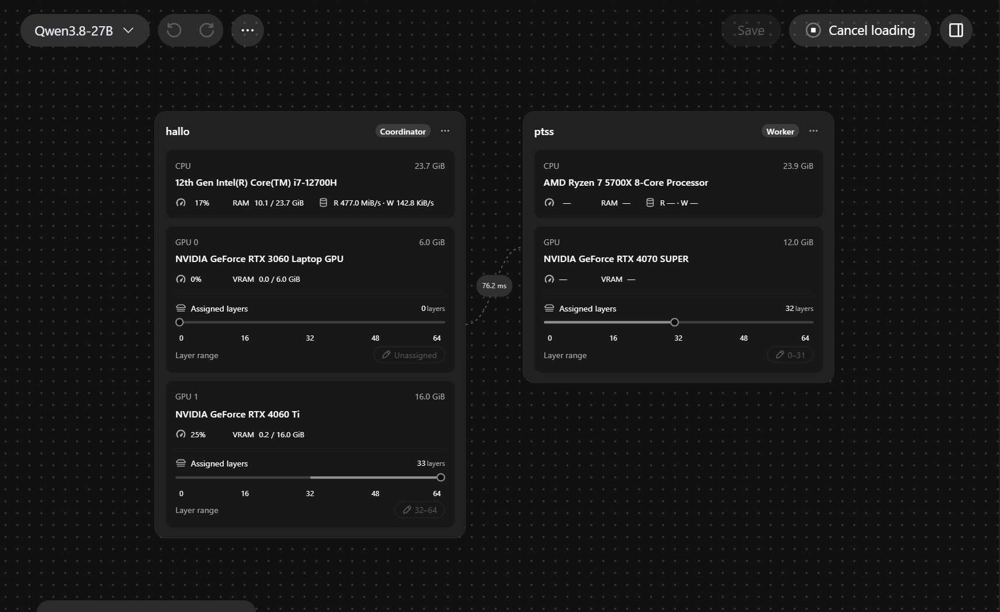

# ModelLoom

**ModelLoom is a Windows desktop app for local and distributed LLM inference with llama.cpp.** Run GGUF models on one GPU, split layers across multiple GPUs in one PC, or share the workload between two PCs over a private network.

- [User Guide](docs/getting-started/user-guide.md) · Launch the preview, load a model, and connect a worker.
- [Developer Guide](docs/getting-started/developer-guide.md) · Set up the checkout, understand the architecture, and run checks.

## Features

- **Visual GPU layer assignment** — Set layer ranges directly on device cards in the Cluster view.
- **Built-in Chat** — Send prompts to a loaded model from the desktop app.
- **Local OpenAI-compatible API** — Send chat completion requests from scripts and other applications.

## Quick start

The Windows x64 development preview runs from source and requires verified runtime assets. Follow the [User Guide](docs/getting-started/user-guide.md) to start the app.

1. Import a GGUF file in **Models**.
2. In **Cluster → Overview**, select the model and assign its layers to the GPUs you want to use.
3. Click **Load model**. Once the model is loaded, open **Chat**.

## Residency Bridge

When both peers support the Residency Bridge, ModelLoom can send a short reference for an eligible tensor write it has already sent. The worker reconstructs the original request byte for byte before passing it to the runtime. This reduces network traffic when eligible writes repeat.

In three reported runs per setup, ModelLoom averaged **27.20 tok/s** in generation and stock llama.cpp RPC averaged **25.82 tok/s**. The setups used different KV cache precision, so the comparison cannot isolate the bridge’s effect. See the [runs and test settings](docs/getting-started/developer-guide.md#performance-experiment).
