# Developer guide

A short onboarding map for the current ModelLoom Windows development checkout. This guide describes the repository; it does not change the implementation gates in [AGENTS.md](../../AGENTS.md) or the accepted decisions.

## Onboard

The documented development host is Windows x64 with Node 24.21.0 and pnpm 11.19.0. Open a normal PowerShell or Windows Terminal session outside Codex at `E:\ModelLoom-Project`:

```powershell
pnpm install --frozen-lockfile
npm run electron dev
```

`npm run electron dev` is the supported interactive launcher for ordinary manual sessions. Use pnpm for dependency, build, and test commands. Startup verifies the development profile and runtime/bootstrap inputs; if preflight fails, resolve it using the full [development guide](../development.md) rather than opening another app copy or starting the runtime directly.

## Repository map

- `apps/desktop/src/renderer/` contains the React screens and feature components for Models, Cluster, Chat, Settings, and API.
- `apps/desktop/src/preload/` exposes narrow desktop bridges; `apps/desktop/src/shared/` defines and validates their command/reply contracts.
- `apps/desktop/src/main/` owns Electron lifecycle, admission, trusted filesystem/runtime work, and caller-bound host connections.
- `packages/core/src/` contains GUI-independent model configuration, protected history, runtime lifecycle, cluster planning, and peer transport code. `packages/core/native/` and `packages/core/scripts/` contain native ownership/helper pieces and their build tooling.
- `components/tailscale/` contains the embedded networking component source and build notes.

The intended runtime path is renderer → preload → trusted main → core owner → verified runtime. The worker path reuses paired peer transport and the restricted RPC helper:

```mermaid
flowchart LR
  UI[React renderer] -->|typed commands| Preload[Preload bridges]
  Preload -->|validated IPC| Main[Electron main]
  Main -->|caller-bound operations| Core[ModelLoom core owner]
  Core -->|verified owned launch| Coordinator[Coordinator llama.cpp runtime]
  Coordinator -->|native RPC stream| PeerClient[Core peer RPC adapter]
  PeerClient <-->|existing authenticated peer transport| PeerWorker[Approved worker host]
  PeerWorker -->|restore each original SET byte-for-byte| Helper[Restricted stock RPC helper]
  Helper <-->|stock RPC operations| GPU[Worker GPU]
  GPU -->|opaque response bytes| Helper
  Helper --> PeerWorker --> PeerClient --> Coordinator
  PeerClient -.->|negotiated input-residency/1 codec| PeerWorker
```



### RPC input residency evidence

The optional `input-residency/1` codec compresses repeated native RPC SET records on the authenticated peer stream. The worker reconstructs every referenced original request before the existing helper receives it; responses remain opaque. The codec does not skip GPU writes or computation and is separate from ModelLoom's disk weight cache. Its implementation is in `packages/core/src/peers/rpc-residency.ts` and `rpc-residency-protocol.ts`.

The evidence in [RPC input residency](../rpc-input-residency.md) establishes byte-level reconstruction and a negotiated native CPU fixture, not model inference equivalence or a live desktop speedup. The fixture performs no model inference. The separate [reported RPC comparison](../research/MODELLOOM-VS-STOCK-RPC.md) has three throughput readings per setup, with different KV cache precision across the setups. Do not present it as proof that input residency improves speed. The user's no-quality-loss requirement still applies; see [speculative decoding constraints](../speculative-decoding.md).

## Run checks

Common checks from the repository root:

```powershell
pnpm --filter @modelloom/desktop test
pnpm --filter @modelloom/core test
pnpm typecheck
pnpm lint
pnpm format:check
```

`pnpm test` runs the root Electron launcher/profile checks followed by desktop and core unit suites. `pnpm test:e2e` runs the browser project; `pnpm test:desktop` is a packaged demo check and requires its package step first. On Windows, `pnpm --filter @modelloom/core test:native` builds the native fixture/ownership binding and runs native integration cases; it is not a model-quality or GPU acceptance test. These suites do not replace live mixed-GPU, release, or inference-equivalence evidence.

Before changing behavior, read the relevant product, technical, integration, security, UI, testing, and decision documents. The [full development guide](../development.md) contains workflow details, test boundaries, and platform-specific procedures. Useful current subsystem references include [local generation](../local-generation.md), [runtime activation](../runtime-activation.md), [development networking](../development-network.md), and [RPC input residency](../rpc-input-residency.md).
