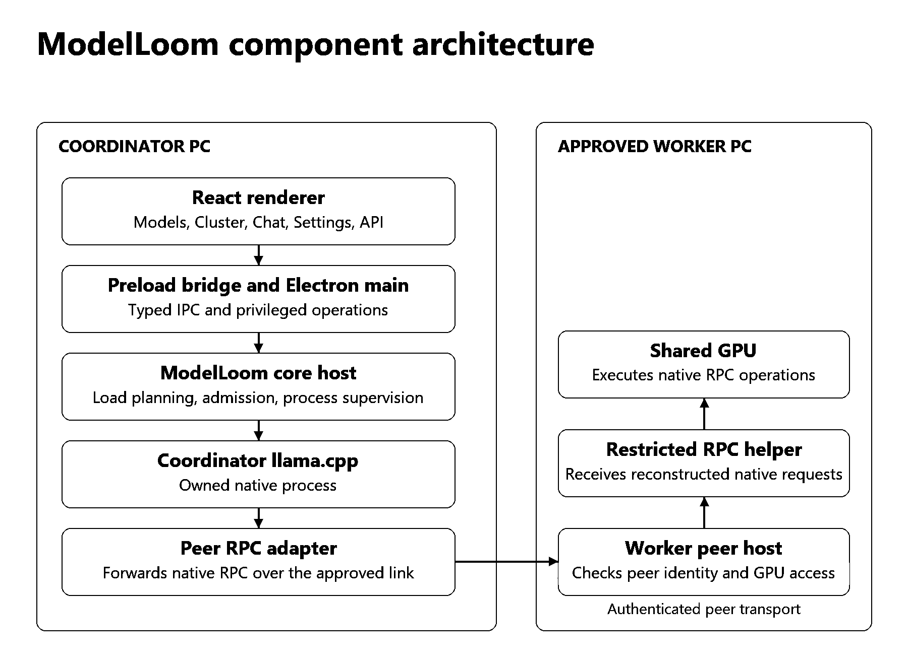
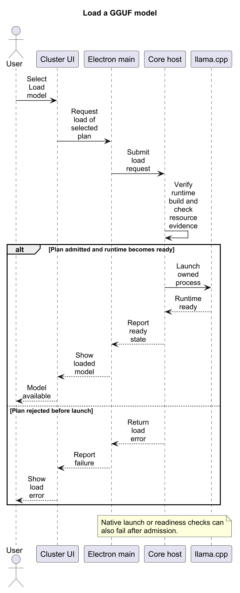
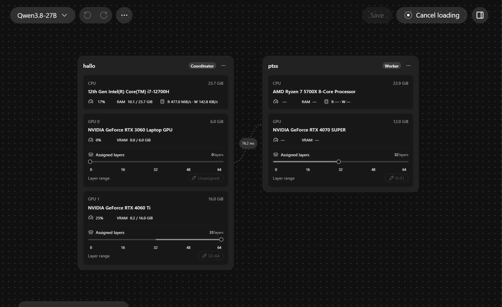
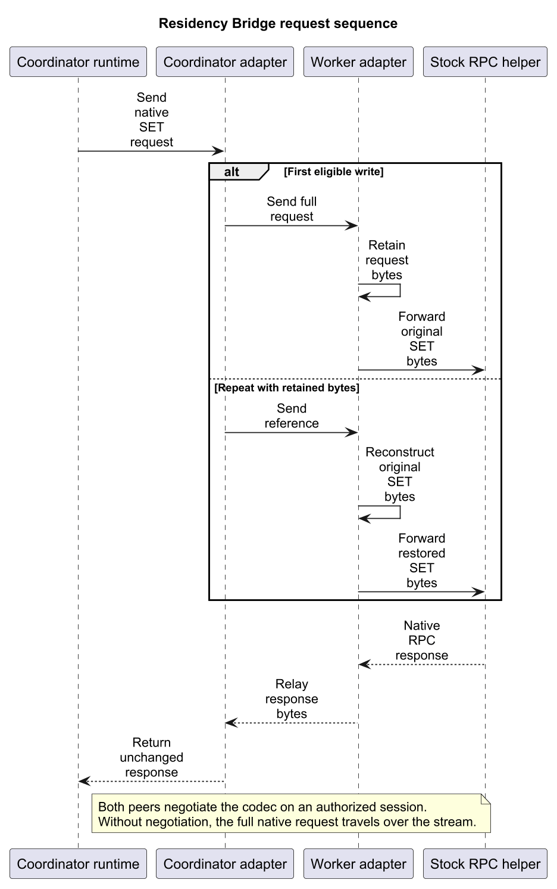

# ModelLoom Developer Guide

Build, test, and extend ModelLoom, a Windows desktop app for local and distributed GGUF inference with llama.cpp. This guide follows a model load from the React interface to the native runtime and explains what to verify when changing that path.

## Contents

- [Introduction](#introduction)
- [Development setup](#development-setup)
- [Architecture and source map](#architecture-and-source-map)
- [Component design](#component-design)
- [Key workflows](#key-workflows)
- [Residency Bridge](#residency-bridge)
- [Build and test](#build-and-test)
- [Manual verification](#manual-verification)
- [Troubleshoot development](#troubleshoot-development)
- [Known limits](#known-limits)
- [Performance experiment](#performance-experiment)
- [Glossary](#glossary)

## Introduction

ModelLoom combines an Electron desktop app, a TypeScript core, and separately installed llama.cpp runtime packages. The desktop app presents the model library, device topology, layer assignment, Chat, and API controls. The core checks whether a proposed load can run, coordinates the runtime lifecycle, and manages the connection to an approved worker when the plan uses a second PC.

Start with the [User Guide](user-guide.md) for the visible workflows. Use this guide to find the code behind them and choose the right validation for a change.

## Development setup

### Prerequisites

| Requirement                                                            | When you need it                                               |
| ---------------------------------------------------------------------- | -------------------------------------------------------------- |
| Windows x64, Git, Node 24.21.0, and pnpm 11.19.0                       | Install dependencies and launch the source desktop app.        |
| Workspace bootstrap assets and signed development runtime assets       | Launch the source desktop app and exercise real model loading. |
| A standalone GGUF and a compatible GPU and runtime                     | Test model loading and generation.                             |
| Go 1.27.3                                                              | Build the embedded networking helper from source.              |
| A second ModelLoom PC on a private LAN or configured Tailscale network | Verify pairing and distributed inference on real hardware.     |

### Launch from source

From a normal PowerShell or Windows Terminal session outside Codex, open the repository root and run the following commands.

```powershell
pnpm install --frozen-lockfile
npm run electron dev
```

`npm run electron dev` is the supported interactive launcher for ordinary manual sessions. Use pnpm for dependency, build, and test commands. Startup verifies the development profile and the workspace bootstrap assets. Install the signed development runtime assets before loading a model. The app keeps installed runtimes under `%USERPROFILE%\.modelloom\runtimes`.

<p align="center">
  
</p>

<p align="center"><em>After starting ModelLoom, open Settings → Runtime and confirm that the expected GGUF build appears in the selector.</em></p>

### Repository layout

```text
ModelLoom/
├── apps/desktop/
│   ├── src/renderer/        React screens and feature state
│   ├── src/preload/         Desktop bridge exposed to the renderer
│   ├── src/shared/          Command and reply contracts
│   ├── src/main/            Electron lifecycle, IPC, and runtime integration
│   ├── scripts/             Packaging and resource staging
│   └── tests/               Playwright browser and packaged desktop tests
├── packages/core/
│   ├── src/                 Model loading, generation, storage, and peers
│   ├── native/              Native bindings and fixtures
│   └── scripts/             Core build tools and host entry points
├── components/tailscale/    Embedded networking helper
├── scripts/                 Workspace launcher and profile checks
├── .github/workflows/       CI definitions
└── docs/                    Guides and application screenshots
```

## Architecture and source map

The renderer calls the typed preload bridge. Electron main owns privileged operations and connects callers to the core host. The core plans loads and supervises the native runtime. When the plan uses a worker, the coordinator's native RPC traffic crosses an authenticated peer connection before it reaches the worker's restricted helper.

To rebuild the Windows x64 networking helper with the pinned Go toolchain, run `node packages/core/scripts/build-network.mjs --target windows-amd64` from the repository root.

<p align="center">
  
</p>

<p align="center"><em>Figure 1. The coordinator owns the model load. When the plan uses a worker, native RPC crosses the authenticated link between the coordinator adapter and the worker peer host.</em></p>

## Component design

| Component                  | Responsibility and entry point                                                                                                                                                                                                                                                |
| -------------------------- | ----------------------------------------------------------------------------------------------------------------------------------------------------------------------------------------------------------------------------------------------------------------------------- |
| Renderer                   | Presents model, cluster, runtime, Chat, and API state. Start in [renderer features](../../apps/desktop/src/renderer/features).                                                                                                                                                |
| Desktop IPC                | Exposes the supported operations through [preload](../../apps/desktop/src/preload/index.ts), shares [contracts](../../apps/desktop/src/shared), and registers handlers in [Electron main](../../apps/desktop/src/main/index.ts).                                              |
| Desktop runtime controller | Coordinates model load and unload from Electron. Start in [runtime-controller.ts](../../apps/desktop/src/main/runtime-controller.ts) and [model-loading-status.ts](../../apps/desktop/src/main/model-loading-status.ts) for the UI's loading state.                           |
| Cluster and runtime core   | Resolves the effective load in [cluster](../../packages/core/src/cluster), checks resource evidence in [preflight.ts](../../packages/core/src/runtime/preflight.ts), and manages lifecycle transitions and process supervision in [runtime](../../packages/core/src/runtime). |
| Runtime package management | Finds installed builds, verifies packages, and installs offers from approved catalogs. Start in [runtime-package](../../packages/core/src/runtime-package).                                                                                                                   |
| Networking and peers       | Manages the networking helper, pairing, peer sessions, and RPC transport. Start in [network](../../packages/core/src/network) and [peers](../../packages/core/src/peers).                                                                                                     |
| Chat, API, and storage     | Start in [generation](../../packages/core/src/generation), [local-api](../../packages/core/src/local-api), [history](../../packages/core/src/history), or [tensor-cache](../../packages/core/src/tensor-cache), depending on the symptom.                                     |

When changing a desktop command, trace the renderer call through preload, the shared contract, and the main handler. Check the success and failure paths at the boundary that owns the operation. For a runtime change, trace the planned selection, the actual process state, and what the UI reports after load, failure, and unload.

## Key workflows

### Import and load a GGUF

1. **Models** indexes the selected file at its existing location. Importing adds a library entry. A successful load still depends on runtime compatibility and resource checks.
2. **Cluster → Overview** holds the selected model and proposed layer assignments. A saved configuration can be reopened later. The active runtime state comes from the current load.
3. **Load model** sends the load request through desktop IPC. Core resolves the effective load and checks the runtime and resource evidence before launching the owned llama.cpp process.
4. The UI reports the resulting load state. Once the runtime is ready, use Chat or the enabled local API to send inference requests.

<p align="center">
  <a href="../diagrams/model-load-sequence.png"></a>
</p>

<p align="center"><em>Figure 2. This sequence compares a rejection before native launch with a successful local load. A native launch or readiness check can also fail after admission.</em></p>

### Pair a worker and distribute layers

1. The worker enables sharing and approves the coordinator. The [User Guide](user-guide.md#connect-a-worker-and-assign-layers) covers the visible pairing steps.
2. The coordinator adds the worker to the canvas and assigns layer ranges. The plan records placement separately from the peer connection.
3. The coordinator opens the RPC session for the load. A connected peer can still fail RPC preparation if the runtime combination or requested GPU is unavailable.
4. Use the runtime result and the coordinator and worker logs together when debugging. A visible peer or a latency reading confirms reachability at that stage. Successful model generation is the end-to-end check.

<p align="center">
  
</p>

<p align="center"><em>The canvas shows which GPUs have planned layers. The Layer assignment summary groups those ranges by device.</em></p>

### Switch runtime builds

**Settings → Runtime** shows the selected GGUF build for the next load and the build used by the active model. To verify switching, select an installed compatible build, unload the active model, then load it again and check **Active runtime**. For a distributed load, verify the selected builds and compatibility on both PCs.

## Residency Bridge

The optional `input-residency/1` codec compresses repeated native RPC SET records on the authenticated peer stream. The worker reconstructs every referenced original request before the existing helper receives it; responses remain opaque. The codec does not skip GPU writes or computation and is separate from ModelLoom's disk weight cache. Its implementation is in `packages/core/src/peers/rpc-residency.ts` and `rpc-residency-protocol.ts`.

<p align="center">
  <a href="../diagrams/residency-bridge-sequence.png"></a>
</p>

<p align="center"><em>Figure 3. The first write and a repeated write both reach the stock RPC helper in their original form. In either case, the adapters relay the response unchanged.</em></p>

### Measured RPC upload savings

In one benchmark run, the Residency Bridge cut coordinator-to-worker RPC traffic from **41.55 MB to 5.36 MB**, an **87.10% reduction**. [Desktop traffic measurement](../research/APP-RESIDENCY-BENCHMARK-2026-10-27.json)

This traffic measurement is separate from the [generation throughput comparison](#performance-experiment). The traffic runs used separate fresh app sessions under variable WAN conditions, which limits what their timings tell us about the codec's effect on speed.

The residency tests verify byte-for-byte reconstruction and negotiation with a native CPU fixture. The fixture performs no model inference. When investigating network savings, compare the bytes sent over the peer connection with the codec enabled and disabled under the same workload. Keep transport savings separate from generation speed and model quality.

## Build and test

### Common commands

Run these commands from the repository root.

```powershell
pnpm typecheck
pnpm lint
pnpm format:check
pnpm test
pnpm build
```

### Automated testing strategy

| What changed                                        | What to run                                                                                     | What it covers                                                                  |
| --------------------------------------------------- | ----------------------------------------------------------------------------------------------- | ------------------------------------------------------------------------------- |
| Launcher or profile handling                        | `node --test scripts/electron.test.mjs scripts/windows-profile.test.mjs`                        | Launch command and Windows development profile checks.                          |
| Desktop UI, shared contracts, or IPC                | `pnpm --filter @modelloom/desktop test`                                                         | Desktop unit and component tests.                                               |
| Planning, runtime policy, storage, or peer behavior | `pnpm --filter @modelloom/core test`                                                            | Core unit and integration tests.                                                |
| Browser interactions                                | `pnpm --filter @modelloom/desktop exec playwright install chromium`, then `pnpm test:e2e`       | Playwright browser project with renderer test servers.                          |
| Native ownership and fixture integration on Windows | `pnpm --filter @modelloom/core test:native`                                                     | Builds native bindings and hosts, then runs native fixture tests.               |
| Packaged desktop integration on Windows             | `pnpm --filter @modelloom/core build:network`, then `pnpm package:demo` and `pnpm test:desktop` | Packaged demo startup, process ownership, and other desktop integration checks. |

`pnpm test` combines the launcher, desktop, and core suites. The [main CI workflow](../../.github/workflows/checks.yml) defines the full job setup for quality, browser, Windows desktop, and security checks. The [network workflow](../../.github/workflows/network.yml) checks the embedded networking build separately.

### Packaging

`pnpm build` builds the renderer. `pnpm package:demo` produces the package used by desktop tests. The Windows installer build is handled by [package-release.mjs](../../apps/desktop/scripts/package-release.mjs), which stages release-specific host assets and checks the runtime trust policy before packaging. Its inputs include an approved runtime catalog and matching resource evidence for CUDA and Vulkan. See [Known limits](#known-limits) for the current state of those inputs.

## Manual verification

Use the source app, approved runtime assets, and a model profile you can already load. Record the app revision, runtime builds, GPUs, model and quantization, context, and layer ranges with any result you intend to compare.

| Check                 | Steps                                                                                                                              | Expected result                                                                                             |
| --------------------- | ---------------------------------------------------------------------------------------------------------------------------------- | ----------------------------------------------------------------------------------------------------------- |
| Source startup        | Launch from a regular terminal and open **Settings → Runtime**.                                                                    | The installed build appears in **GGUF**. **Active runtime** reflects whether a model is loaded.             |
| Single-PC inference   | Import a supported GGUF, assign its layers to a compatible local GPU, load the model, send a short prompt, then unload.            | Chat returns a response while the model is loaded. After unload, the runtime returns to the unloaded state. |
| Two-PC inference      | Pair an approved worker, assign a valid layer split across both PCs, load the model, and generate a response.                      | The app shows the planned ranges and generation succeeds with the worker participating.                     |
| Runtime switch        | With a model loaded, select another installed compatible build, unload, and load again.                                            | The selected build applies on the next load. **Active runtime** reports the build actually in use.          |
| Worker reconnect      | In an idle cluster, interrupt the link briefly and restore it with sharing and approval intact.                                    | The approved worker becomes reachable again. Confirm a subsequent load and generation separately.           |
| Unsaved configuration | Load an unsaved configuration, navigate away, discard edits, and return to **Cluster → Overview** while the model is still loaded. | The active assignment remains visible while that load is in memory.                                         |

For a bug report, include the first failing step, expected and observed results, and relevant timestamps from each device. For a performance report, include sampling settings, KV cache precision, and whether the prompt was already cached.

## Troubleshoot development

| Symptom                                        | Check                                                                                                                   |
| ---------------------------------------------- | ----------------------------------------------------------------------------------------------------------------------- |
| Launcher stops before opening a window         | Check the pinned Node and pnpm versions, then verify the workspace bootstrap assets and development profile.            |
| A runtime is missing from the GGUF picker      | Check **Settings → Runtime → Manage installed runtimes** and verify the package was installed for this Windows profile. |
| A worker connects but the model will not load  | Check the approved GPU, the layer allocation, and the compatible verified RPC runtime on both PCs.                      |
| Load reports that resource evidence is missing | Check the exact build, GPU placement, and load profile against the approved evidence.                                   |
| Browser tests fail before reaching a page      | Check that Playwright Chromium is installed and that ports 5175 and 5176 are available.                                 |

For desktop runtime failures, start with `%USERPROFILE%\.modelloom\logs\runtime.log`. For a split load, compare coordinator and worker timestamps to see whether the failure happened during pairing, RPC session setup, resource checks, or native startup.

## Known limits

- Windows x64 is the documented source-app target. A networking helper build for another platform establishes only that component's build status.
- The public installer is still being prepared on this branch. The current [trust policy](../../packages/core/src/runtime-package/trust-policy.ts) pins a production root, with the approved catalog and memory report lists still empty. The release packager rejects incomplete inputs.
- Browser, native fixture, and packaged demo checks cover their respective paths. Live model loading, mixed-GPU compatibility, release installation, and output equivalence each require their own evidence.

## Performance experiment

The table records the generation throughput readings reported by the operator. Each mean gives equal weight to the three runs in its column.

| Run      | ModelLoom (tok/s) | Stock llama.cpp RPC (tok/s) |
| -------- | ----------------: | --------------------------: |
| 1        |             27.02 |                       25.91 |
| 2        |             27.63 |                       26.01 |
| 3        |             26.95 |                       25.55 |
| **Mean** |         **27.20** |                   **25.82** |

The difference is **1.38 tok/s**, or **5.33%** relative to the stock mean. The percentage uses the unrounded means.

The operator confirmed they reused the earlier test setup. The stock run used **Qwen3.8-27B IQ4_XS** with **CUDA b11306**, **MTP enabled**, and a **50/50 layer split** with the worker first and the coordinator last. The stock startup log confirms **30,720 tokens in one slot** and MTP initialization. The earlier setup used **BF16 K/V** in stock llama.cpp and **Q8_0 K/V** in ModelLoom.

The six readings come from the operator. The stock startup log establishes launch settings, while per-run logs would establish the exact prompt, sampling, and timing for each reading. The KV precision difference limits attribution of the throughput difference to the residency bridge.

## Glossary

| Term             | Meaning                                                                                                                    |
| ---------------- | -------------------------------------------------------------------------------------------------------------------------- |
| Coordinator      | The PC that owns the model load and manages the inference session.                                                         |
| Worker           | An approved peer that shares a GPU for remote layer execution.                                                             |
| GGUF             | The model file format imported into the ModelLoom library.                                                                 |
| RPC              | The remote procedure calls used to reach GPU operations on a worker.                                                       |
| Runtime build    | An installed llama.cpp build identified by its backend and version.                                                        |
| KV cache         | Attention key and value data retained for reuse during generation. Its precision affects memory and can affect throughput. |
| Residency Bridge | The optional peer protocol that sends references for eligible repeated tensor writes.                                      |
