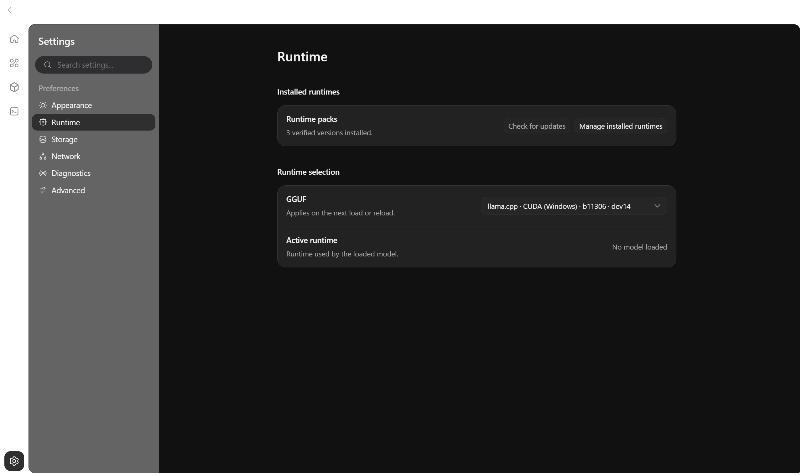

# ModelLoom Developer Guide

Build and test the ModelLoom desktop app from source.

## Contents

- [Development setup](#development-setup)
- [Architecture and source map](#architecture-and-source-map)
- [Residency Bridge](#residency-bridge)
- [Build and test](#build-and-test)
- [Troubleshoot development](#troubleshoot-development)
- [Performance experiment](#performance-experiment)

## Development setup

The documented development host is Windows x64 with Node 24.21.0 and pnpm 11.19.0. Open a normal PowerShell or Windows Terminal session outside Codex at `E:\ModelLoom-Project`:

```powershell
pnpm install --frozen-lockfile
npm run electron dev
```

`npm run electron dev` is the supported interactive launcher for ordinary manual sessions. Use pnpm for dependency, build, and test commands. Startup verifies the development profile and the workspace bootstrap assets. Install the signed development runtime assets before loading a model. The app keeps installed runtimes under `%USERPROFILE%\.modelloom\runtimes`.



*After starting ModelLoom, open Settings → Runtime and confirm that the expected GGUF build appears in the selector.*

## Architecture and source map

- `apps/desktop/src/renderer/` contains the React screens and feature components for Models, Cluster, Chat, Settings, and API.
- `apps/desktop/src/preload/` exposes narrow desktop bridges; `apps/desktop/src/shared/` defines and validates their command/reply contracts.
- `apps/desktop/src/main/` owns Electron lifecycle, admission, trusted filesystem/runtime work, and caller-bound host connections.
- `packages/core/src/` contains GUI-independent model configuration, protected history, runtime lifecycle, cluster planning, and peer transport code. `packages/core/native/` and `packages/core/scripts/` contain native ownership/helper pieces and their build tooling.
- `components/tailscale/` contains the embedded networking component. With Go 1.27.3 installed, build the Windows x64 helper with `node packages/core/scripts/build-network.mjs --target windows-amd64` from the repository root.

The intended runtime path is renderer → preload → trusted main → core owner → verified runtime. The worker path reuses paired peer transport and the restricted RPC helper:

```mermaid
flowchart LR
  UI[React renderer] -->|typed commands| Preload[Preload bridges]
  Preload -->|validated IPC| Main[Electron main]
  Main -->|caller-bound operations| Core[ModelLoom core owner]
  Core -->|verified owned launch| Coordinator[Coordinator llama.cpp runtime]
  Coordinator -->|native RPC stream| PeerClient[Core peer RPC adapter]
  PeerClient <-->|existing authenticated peer transport| PeerWorker[Approved worker host]
  PeerWorker -->|restore each original SET byte-for-byte| Helper[Restricted stock RPC helper]
  Helper <-->|stock RPC operations| GPU[Worker GPU]
  GPU -->|opaque response bytes| Helper
  Helper --> PeerWorker --> PeerClient --> Coordinator
  PeerClient -.->|negotiated input-residency/1 codec| PeerWorker
```



## Residency Bridge

The optional `input-residency/1` codec compresses repeated native RPC SET records on the authenticated peer stream. The worker reconstructs every referenced original request before the existing helper receives it; responses remain opaque. The codec does not skip GPU writes or computation and is separate from ModelLoom's disk weight cache. Its implementation is in `packages/core/src/peers/rpc-residency.ts` and `rpc-residency-protocol.ts`.

The residency tests verify byte-for-byte reconstruction and negotiation with a native CPU fixture. The fixture performs no model inference.

## Build and test

Build the desktop application with `pnpm build`. Run these checks from the repository root:

```powershell
pnpm --filter @modelloom/desktop test
pnpm --filter @modelloom/core test
pnpm typecheck
pnpm lint
pnpm format:check
```

`pnpm test` runs the root Electron launcher/profile checks followed by desktop and core unit suites. `pnpm test:e2e` runs the browser project; `pnpm test:desktop` is a packaged demo check and requires its package step first. On Windows, `pnpm --filter @modelloom/core test:native` builds the native fixture/ownership binding and runs native integration cases; it is not a model-quality or GPU acceptance test. These suites do not replace live mixed-GPU, release, or inference-equivalence evidence.

## Troubleshoot development

| Symptom | Check |
| --- | --- |
| Launcher stops before opening a window | Check the pinned Node and pnpm versions, then verify the workspace bootstrap assets and development profile. |
| A runtime is missing from the GGUF picker | Check **Settings → Runtime → Manage installed runtimes** and verify the package was installed for this Windows profile. |
| A worker connects but the model will not load | Check the approved GPU, the layer allocation, and the compatible verified RPC runtime on both PCs. |

## Performance experiment

The table records the generation throughput readings reported by the operator. Each mean gives equal weight to the three runs in its column.

| Run      | ModelLoom (tok/s) | Stock llama.cpp RPC (tok/s) |
| -------- | ----------------: | --------------------------: |
| 1        |             27.02 |                       25.91 |
| 2        |             27.63 |                       26.01 |
| 3        |             26.95 |                       25.55 |
| **Mean** |         **27.20** |                   **25.82** |

The difference is **1.38 tok/s**, or **5.33%** relative to the stock mean. The percentage uses the unrounded means.

The operator confirmed they reused the earlier test setup. The stock run used **Qwen3.8-27B IQ4_XS** with **CUDA b11306**, **MTP enabled**, and a **50/50 layer split** with the worker first and the coordinator last. The stock startup log confirms **30,720 tokens in one slot** and MTP initialization. The earlier setup used **BF16 K/V** in stock llama.cpp and **Q8_0 K/V** in ModelLoom.

The six readings come from the operator. The stock startup log establishes launch settings, while per-run logs would establish the exact prompt, sampling, and timing for each reading. The KV precision difference limits attribution of the throughput difference to the residency bridge.
