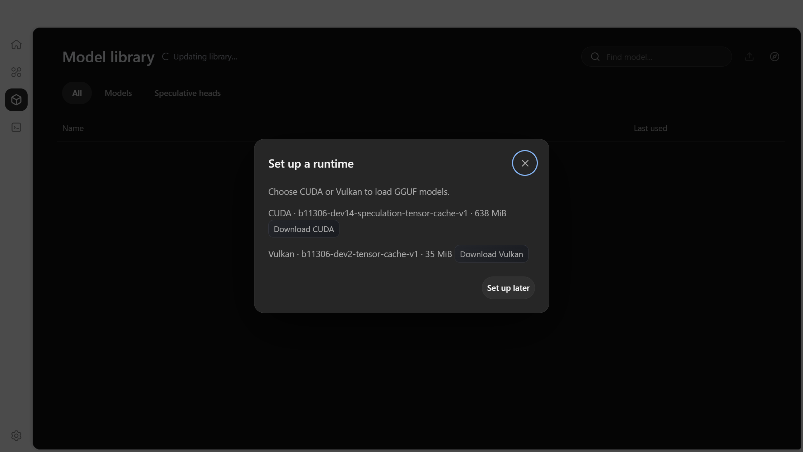
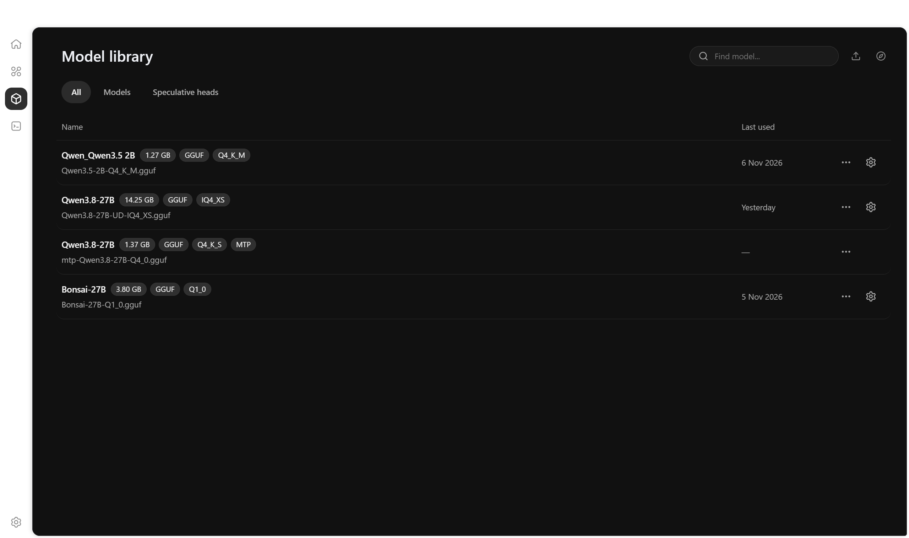
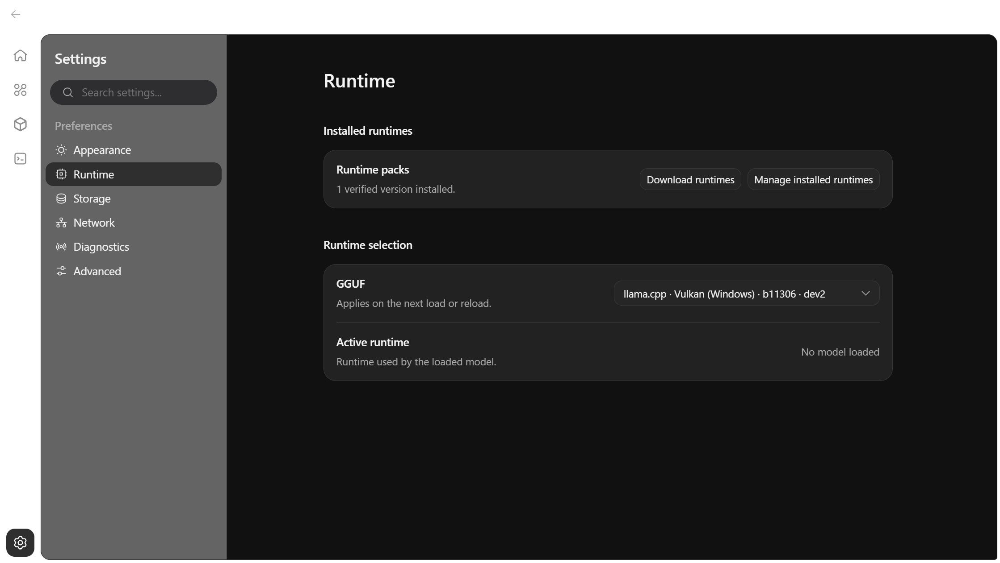
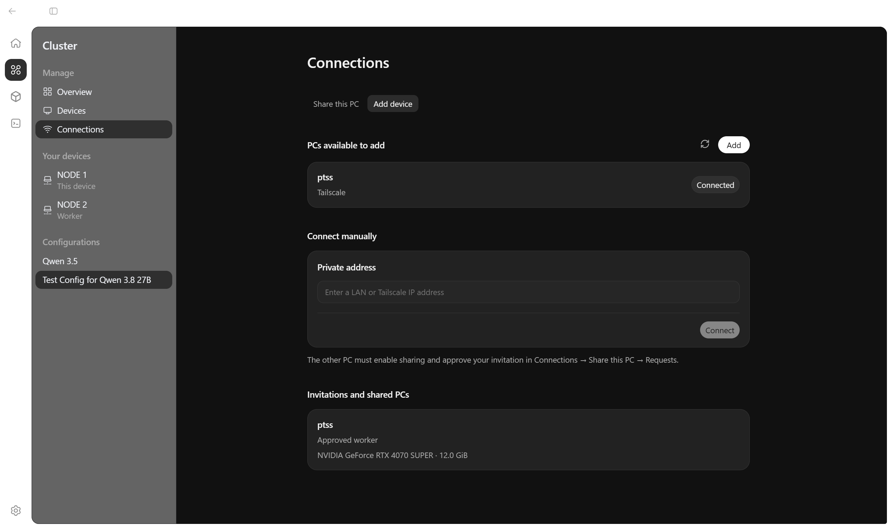
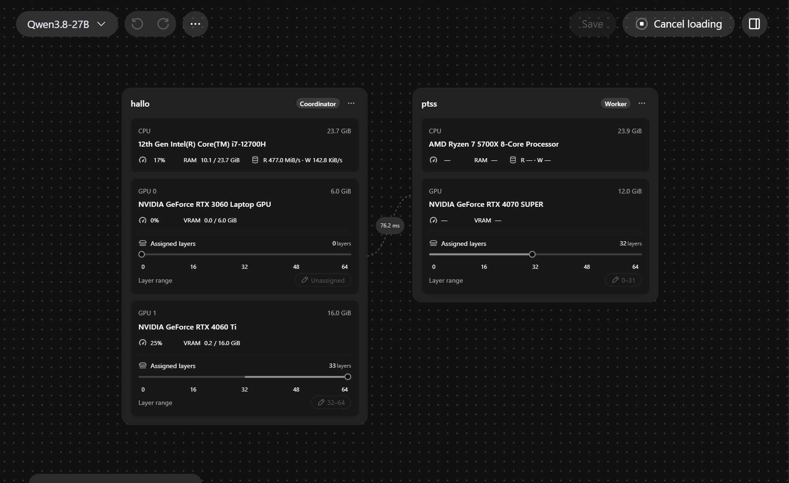

# ModelLoom User Guide

Use ModelLoom on Windows x64 to load a GGUF model on your own GPUs and chat with it. This guide starts with one PC, then shows how to add a worker.

## Contents

- [Install ModelLoom](#install-modelloom)
- [Import a GGUF model](#import-a-gguf-model)
- [Load a model and start a chat](#load-a-model-and-start-a-chat)
- [Choose a runtime](#choose-a-runtime)
- [Connect a worker and assign layers](#connect-a-worker-and-assign-layers)
- [Troubleshooting and current limits](#troubleshooting-and-current-limits)

## Install ModelLoom

1. Download `ModelLoom-Setup-x64.exe` and `SHA256SUMS.txt` from the [Windows x64 release](https://github.com/haowern98/ModelLoom/releases/tag/v0.1.1).
2. In PowerShell, run this command from the download folder and compare the hash with the installer entry in `SHA256SUMS.txt`.

   ```powershell
   Get-FileHash -Algorithm SHA256 .\ModelLoom-Setup-x64.exe
   ```

3. Run the installer after the hash matches. The preview installer is unsigned, so Windows may show an unknown-publisher or SmartScreen warning.
4. Open **ModelLoom**. In **Set up a runtime**, choose **Download CUDA** or **Download Vulkan**. ModelLoom downloads and verifies the signed llama.cpp b11306 package, then selects it for your first GGUF model load.

<p align="center">
  
</p>

<p align="center"><em>Choose a runtime to download on first launch.</em></p>

For source setup, see the [Developer Guide](developer-guide.md#development-setup).

## Import a GGUF model

1. Open **Models** and choose **Import GGUF**.
2. Select a standalone GGUF file and wait for **Indexing…** to finish.
3. Keep the file at that location. ModelLoom indexes the source; it does not copy or move it.

Import a standalone GGUF supported by your verified runtime. An indexed model still needs to pass runtime and resource checks before it can load.

<p align="center">
  
</p>

<p align="center"><em>Use the import icon next to the search field to add a GGUF file.</em></p>

## Load a model and start a chat

1. Open **Cluster → Overview** and choose the imported model in the model picker.
2. For a new allocation, choose **Auto place** or assign layer ranges manually. Auto place prepares a proposal; click the play button again to load. Saving a named configuration is optional.
3. Wait for the load action to finish and the status to report **Loaded**. Loading rechecks the model file, selected runtime, and available resources.
4. Open **Chat**, enter a prompt, and choose **Send**. Send is available when a model is loaded. Use Chat's Stop control to interrupt a response; use **Unload model** in Cluster when you want to release the model before changing runtimes or placements.

Use the validated settings for the model and devices in this preview. Unsupported load tuples, insufficient free memory, or an unverified runtime are rejected rather than silently changing the model or its quality.

## Choose a runtime

Open **Settings → Runtime** and choose **Download runtimes** to install the other backend. Both can stay installed. Select the build you want in **GGUF**. The selection applies on the next model load or reload. **Active runtime** shows which build the loaded model is using. For distributed inference, use compatible approved builds on both PCs.

<p align="center">
  
</p>

<p align="center"><em>Use Download runtimes to install another backend, then choose it in the GGUF selector.</em></p>

## Connect a worker and assign layers

Use two ModelLoom PCs on a reachable private LAN address or an already configured Tailscale network. In this guide, the **worker** shares a GPU and the **coordinator** assigns model layers to it.

1. On the worker, open **Cluster → Connections → Share this PC**. Select the GPU to share, choose the worker's reachable private address if more than one is listed, then turn on **Allow connections**. Approve the Windows permission prompt if ModelLoom requests it.
2. On the coordinator, open **Cluster → Connections → Add device**. Enter the worker's LAN or Tailscale IP address and choose **Connect**.
3. On the worker, open the incoming request under **Share this PC → Requests** and choose **Review**. The dialog shows a six-digit pairing code.
4. On the coordinator, find the pending invitation under **Add device → Invitations and shared PCs**, choose **Verify code**, and enter the worker's code. The code expires after five minutes.
5. Return to the worker's request and choose **Allow** once the code is verified. Approval grants this coordinator access to the selected shared GPU. You can later remove that access with **Revoke access**.
6. On the coordinator, return to **Cluster → Overview**, select the worker GPU in the allocation, and load the validated configuration. Both PCs need a compatible verified RPC runtime; use the same compatible build on both.

<p align="center">
  
</p>

<p align="center"><em>Choose Add to find a worker, or enter its private address under Connect manually.</em></p>

When the worker is added, both device cards appear on the canvas. The **Layer assignment** section lists the ranges on each device. In this example, Node 2 has layers 0–31 and Node 1 has layers 32–64. The overview shows the planned ranges before loading.

<p align="center">
  
</p>

## Troubleshooting and current limits

| What you see                                     | What to check                                                                                                                                                                                    |
| ------------------------------------------------ | ------------------------------------------------------------------------------------------------------------------------------------------------------------------------------------------------ |
| **No models imported**                           | Finish library restoration, then import a supported standalone GGUF. Import does not download models.                                                                                            |
| The model is **unavailable** after restart       | The indexed source path may have moved or changed. Select the valid file again to refresh the entry.                                                                                             |
| Import says the file cannot be safely opened     | Choose a normal standalone copy, not a shortcut, hard link, reparse point, or a file held by another program.                                                                                    |
| Load rejects the model or settings               | Confirm it is the approved model and use a validated runtime, placement, and load profile. Do not lower precision or change context to bypass the gate.                                          |
| Load reports insufficient resources              | Close other GPU/memory workloads and retry. If the required reserve is still unavailable, the profile cannot load on the current resources.                                                      |
| Worker is unavailable or pairing fails           | Check the worker address, its sharing switch, the Windows Firewall prompt, and that both PCs run a compatible ModelLoom version. Reconnect and use a fresh code if the five-minute code expired. |
| `RPC_PACKAGE_REQUIRED` or `INCOMPATIBLE_RUNTIME` | Install/select an approved compatible peer runtime on both PCs, then reconnect and retry.                                                                                                        |
| Chat cannot send                                 | Open Cluster and confirm the model is **Loaded**. If loading failed, resolve the load error before retrying.                                                                                     |
| Runtime cleanup could not be confirmed           | Loading remains blocked until cleanup is safe. Quit and reopen ModelLoom before another allocation; do not terminate a runtime by process name.                                                  |

For startup and build checks, see the [Developer Guide](developer-guide.md).
